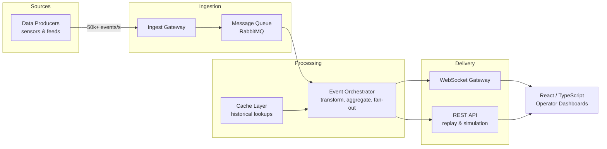
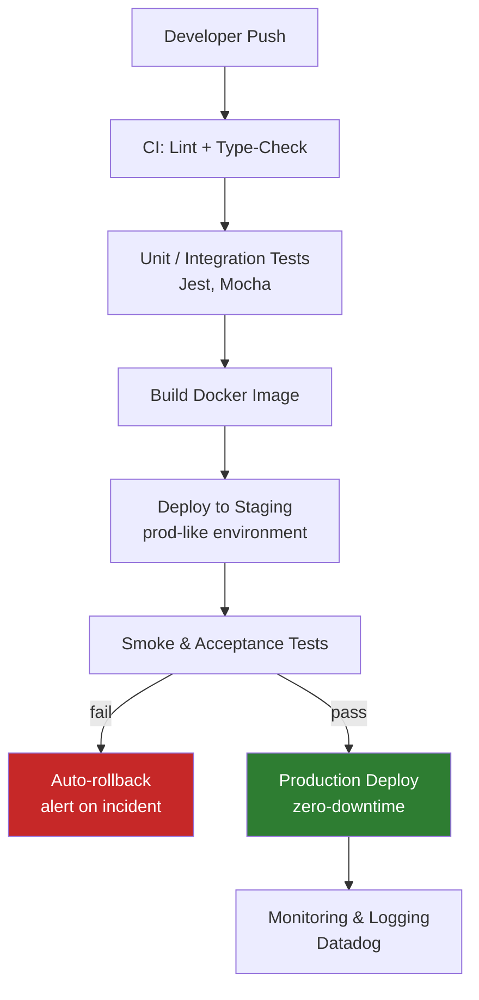
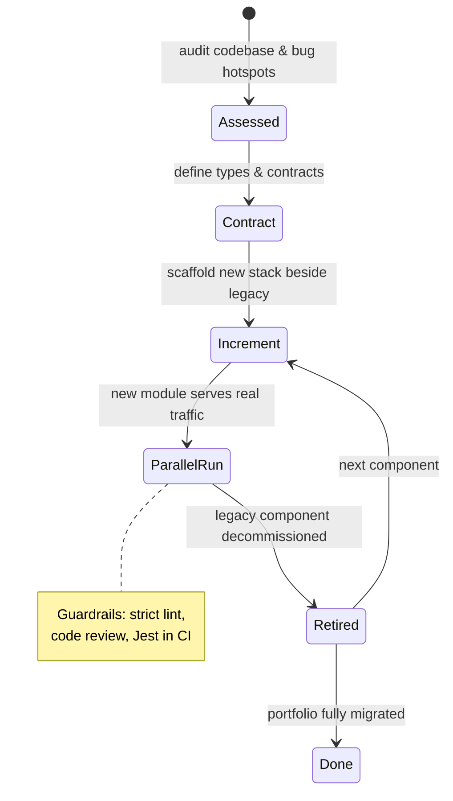

> **Superseded.** This is the original import, kept for history. It is not the build input. Case-study content lives in `client/src/portfolio.config.ts` (ADR-0002), and some values here were dropped (ADR-0001), e.g. 99.99%.

# 📐 Architecture Portfolio

Three architectures that solve three recurring engineering problems: **high-throughput real-time data**, **unreliable release processes**, and **legacy erosion**.

---

## 1. High-Throughput Real-Time Event Pipeline

**Problem:** Deliver live data from thousands of concurrent sources to operator dashboards with sub-50ms end-to-end latency — with no dropped messages under peak load.

**Key decisions:**
- A **message queue** decouples producers from consumers, absorbing load spikes without backpressure reaching the ingest layer.
- The **event orchestrator** fans out processed events over **WebSockets**; each client subscribes only to its scope, keeping payloads small.
- Consumers are horizontally scalable — throughput scales by adding instances, not re-architecting.

**Result:** 50k+ concurrent data points processed with sub-50ms average end-to-end latency, 99.99% availability.

---

## 2. Industrialized CI/CD Delivery Pipeline

**Problem:** Manual deployments were slow and error-prone — every release was a risk event.

**Key decisions:**
- **Parallelized stages** — lint, type-check, and unit tests run concurrently, cutting pipeline wall time.
- **Containerization everywhere** — one Docker image promoted through environments; what you test is what you ship.
- A **prod-like staging environment** de-risks releases before they touch production.

**Result:** 40% reduction in deployment time, regression-free releases, 80%+ test coverage as a permanent safety net.

---

## 3. Incremental Legacy Modernization (Strangler Fig)

**Problem:** A weakly-typed, heterogeneous legacy frontend was generating recurring bugs and dragging team velocity down. A full rewrite was impossible — the system had to keep serving users during migration.

**Key decisions:**
- **Strangler-fig pattern:** new features ship in the new stack, old components migrate opportunistically — no big-bang rewrite, no feature freeze.
- **TypeScript as the quality engine:** strict typing catches entire bug classes at compile time, not in production.
- A **shared component library (Storybook)** makes the "new" path the easiest path for every developer.

**Result:** 30% fewer frontend bug reports (validated by QA & support), >95% sprint acceptance rate, migration completed without a single release freeze.

---

*Every architecture above was designed around one question: "what breaks first under pressure?" — the pipeline absorbs it, the CI/CD gate prevents it, the migration isolates it.*